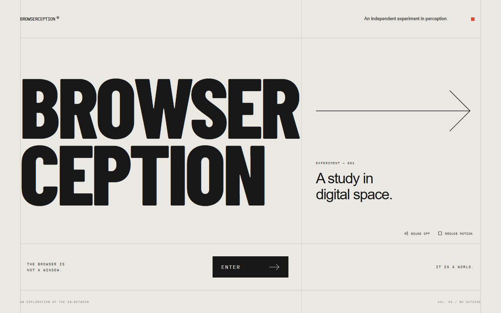

# BROWSERCEPTION

**THE BROWSER IS NOT A WINDOW. IT IS A WORLD.**

ブラウザの紙面を折り開き、その内部にある巨大な文字建築を通り抜け、
最初のページを映したモニターから帰ってくる、5シーンのインタラクティブ作品。



## 起動

Node.js 24を推奨します。外部サービスのアカウントやAPIキーは不要です。

```sh
npm ci
npm run dev
```

表示されたローカルURL（通常は http://localhost:5173 ）をブラウザで開きます。

```sh
npm run typecheck
npm test
npm run build
npm run preview
```

ブラウザの回帰テストは必要な開発サーバーを自動で起動します。スクリーンショットやトレースは Git 対象外の `test-results/` に保存し、既存の資料画像を上書きしません。

```sh
npx playwright install chromium
npm run test:browser
```

既存のEdgeを使う場合はPowerShellで `$env:PLAYWRIGHT_CHANNEL='msedge'` を設定します。
本番プレビューを検証する場合は `BROWSERCEPTION_URL` にそのURLを設定できます。

この制作環境ではWSL 2の `/home/ibi/projects/three.js_test` に依存関係と
開発サーバーを置いています。Windows側の本リポジトリがソース納品先です。

```powershell
# Windowsの編集内容をWSLへ同期して起動
wsl -d Ubuntu -- bash /mnt/d/Work/Projects/three.js_test/scripts/sync-wsl.sh dev
# 初回依存関係の導入
wsl -d Ubuntu -- bash /mnt/d/Work/Projects/three.js_test/scripts/sync-wsl.sh install
# 検証
wsl -d Ubuntu -- bash /mnt/d/Work/Projects/three.js_test/scripts/sync-wsl.sh build
```

`scripts/setup-wsl.sh` はこのPC用の任意セットアップです。公式Node.js配布の
SHA-256を検証してユーザー領域へ展開し、WSL内に開発コピーを作成します。
通常の他のPCでは `npm ci` だけで構いません。同期スクリプトはWSL側の
同名ソースを上書きするため、編集は片側に統一してください。

## 操作

| 操作 | 効果 |
| --- | --- |
| ENTER | 紙面を開いて内部へ入る |
| マウス移動 | 視差・視線・巨大カーソルの反応 |
| スクロール / 上下キー / タッチで縦スワイプ | 内部の進行を調整 |
| CONTINUE | 導線に沿って先へ進む |
| モニターの画面 / ENTER THE FAMILIAR / Enter | 元のページへ帰る |
| Escape / BACK TO SURFACE | 途中で最初の画面へ戻る |
| SOUND / M | 音のオン・オフ（初期状態はオフ） |
| REDUCE MOTION | 揺れ・視差を抑え、直線のゆっくりした導線に変更 |

操作しなくても導線は自動で進み、モニター前で待機します。
2周目以降は巨大カーソルの向きが少しずつ変わります。

## 実装

TypeScript / Three.js / Vite / GLSL / HTML・CSS / Web Audio API。
Reactなし。DOMの実際のレイアウトを同じ透視投影の立体パネルへ置き換え、
ページのテクスチャを空間のモニターにも再利用しています。立体建築は
実際の押し出し文字とインスタンス化ジオメトリで、動画や背景画像ではありません。

- [体験と技術構成](docs/ARCHITECTURE.md)
- [検証記録・制約](docs/QA.md)
- [コンセプトボード](docs/concept.png)
- [画像生成による設計案とプロンプト](docs/CONCEPT.md)

フォントを含むランタイム素材はローカルにバンドルします。音響は合成音のみ。
画像生成によるコンセプトボードは設計資料で、作品の描画には使いません。
GPU負荷に応じたDPR調整、狭い画面での軽量描画、非表示タブの一時停止、
WebGL非対応・コンテキスト喪失時の案内を実装しています。

## トラブルシューティング

- ENTERが反応しない場合は、フォントとページの準備が終わるまで少し待ちます。
  失敗時のTRY AGAINで再試行できます。
- WebGL 2が使えない場合は、最新のブラウザとグラフィックスアクセラレーションを
  確認してください。WebGLなしでは3D体験は再現せず、元のページと案内を表示します。
- 音は初期状態でオフです。SOUND OFFを押して有効にしてください。
- ホットリロードは検証中の進行をリセットする場合があります。
- `npm run build` のThree.jsチャンクサイズ通知はライブラリ本体に由来します。
  圧縮配信サイズと実機描画を検証し、無理な細分化はしていません。

公開サーバーへのデプロイやGitHubへのpushは、この実装作業では実行していません。

## メンテナンス検証

`npm run check` で型・単体テスト・ビルドをまとめて実行できます。CI は同じ確認と Chromium の回帰テストを実行します。Three.js の更新に伴い、既存の Helvetiker 書体は同一データを `src/assets/` に保持し、オフライン表示を維持しています。
